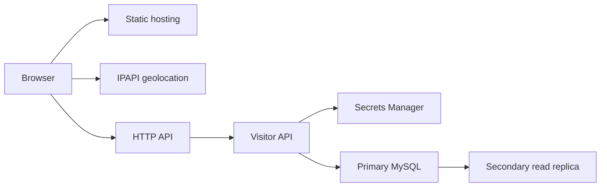
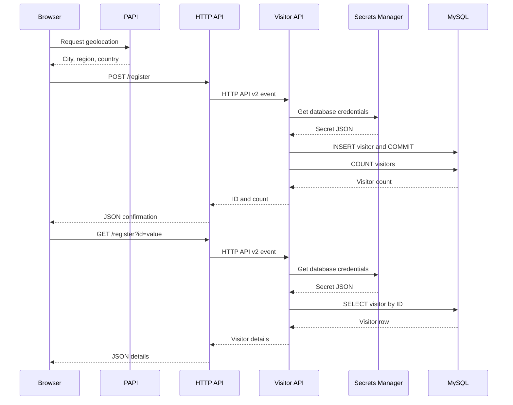

# Architecture

## Architecture Analysis

### System Overview and Architectural Style

A synchronous N-tier application separates a static browser presentation tier, API Gateway/Python Lambda application tier, and MySQL RDS data tier. CloudFormation nested stacks and CodeBuild buildspecs express deployment. Application logic is inline in templates, with no separate domain module. This is observed structure, not a newly selected architecture.

### Component Relationships

Text fallback: the browser downloads the static visitor portal through CloudFront/private S3, requests external geolocation, and calls HTTP API. HTTP API invokes Visitor API, which obtains Secrets Manager credentials and reads/writes regional MySQL. Primary MySQL replicates to a secondary read replica. Infrastructure provisions these resources; Deployment preparation packages and publishes them. Schema initializer is a separate, currently disconnected template.

### Data Flow and Ownership

Static visitor portal owns DOM/network presentation; Visitor API owns insert/lookup behavior for `VISITOR_LOG`; Schema initializer owns the existing additive table DDL. Infrastructure owns resource relationships and replication; Deployment preparation owns packaging and upload order. API and initializer share database configuration and table assumptions without a schema-version contract. Every non-OPTIONS API call obtains credentials and opens a fresh connection.

## Interaction Diagrams

Text fallback: registration obtains geolocation, posts location fields, retrieves database credentials, inserts and commits one visitor, then counts rows and returns the ID/count. Lookup retrieves credentials, selects by supplied ID and publicly returns IP/location. The post-commit count may fail after the insert succeeds; retries have no idempotency boundary. Initializer create/update intends `CREATE TABLE IF NOT EXISTS`; delete acknowledges without deleting rows, but undefined environment keys prevent successful initialization as declared.

## Existing Decisions and Constraints

- Private RDS and VPC Lambda use private subnets and one NAT gateway. Primary MySQL is Multi-AZ; a secondary regional read replica is not an automatically writable standby. Retain this as the cost-sensitive baseline, subject to necessary changes authorized by the recovery revision.
- Static S3 uses public-access blocking, versioning and CloudFront OAC; CloudFront has one primary origin and no failover origin group. Cross-region object and secret replication exist independently.
- Nested logical IDs, physical names, regional exports and `visitor-app-dev-primary` / `visitor-app-dev-secondary` stack names are preservation boundaries. Branding must not rename them.
- CloudFront has no custom alias/certificate or DNS resources. Existing CORS and visitor lookup are public; new borrower records must not inherit public record lookup.

## Improvement Opportunities and Impact

Frontend, Visitor API, Schema initializer, API routes, parent template and buildspecs must change together for library checkout. Additive migration and a writable-primary transaction boundary are necessary to preserve visitor rows while implementing availability/idempotency. Deployment preparation must fix `App/` casing, generated endpoint configuration, remote nested-template packaging and artifact paths. A new frontend framework remains unnecessary. The recovery revision requires reconsidering database/coordination alternatives if unconditional automatic write recovery or stronger durability is required; final contracts and safety mechanisms belong to later design stages.

Diagram syntax was checked against the restricted flowchart/sequence grammar before writing; no Mermaid renderer is available in this environment. Source evidence and precise line references are in the developer handoff; runtime flows were not exercised.

## Requested Target Architecture: Virginia to Ohio

**Status: proposed design revision; not implemented or live tested.** The target primary is `us-east-1`; the recovery region is `us-east-2`. Preserve the presentation → regional API/Lambda → MySQL tiers, using a pre-provisioned standby that requires database promotion before writes. This is a cost-sensitive warm-standby intent, not an instantly writable secondary. RTO, RPO, acceptable lost acknowledged checkouts and maximum ongoing cost remain open business decisions. [AWS recovery objectives](https://docs.aws.amazon.com/wellarchitected/latest/reliability-pillar/rel_planning_for_recovery_objective_defined_recovery.html) requires objectives to drive the strategy; [AWS disaster recovery strategy](https://docs.aws.amazon.com/wellarchitected/latest/framework/rel_planning_for_recovery_disaster_recovery.html) explains resilience/cost tradeoffs.

- **Static content:** `www.homenub.com` → CloudFront with primary/Ohio private S3 origins, both OAC-authorized. Replicate versioned releases and generated configuration through S3 CRR; release manifests verify compatible assets are present in Ohio before declaring readiness. Use origin failover for static GET/HEAD/OPTIONS. CloudFront never fails over POST, so it cannot supply checkout recovery. [CloudFront failover methods](https://docs.aws.amazon.com/AmazonCloudFront/latest/DeveloperGuide/high_availability_origin_failover.html).
- **API addressing:** browser configuration uses stable `https://api.homenub.com`, mapped to regional HTTP API custom domains in both regions. Provision matching ACM certificates in each API region and the website certificate for CloudFront in us-east-1 before incidents. Route 53 API routing remains on the active writer until a controller confirms the promoted region is write-ready; a failed primary probe alone must not expose standby writes. Regional custom domains/certificates follow [API Gateway requirements](https://docs.aws.amazon.com/apigateway/latest/developerguide/http-api-custom-domain-names.html); health-aware DNS follows [Route 53 guidance](https://docs.aws.amazon.com/Route53/latest/DeveloperGuide/dns-failover-configuring.html).
- **Data:** private primary MySQL with Multi-AZ and an Ohio cross-region read replica, regional credentials/keys, deployed API/runtime dependencies and replicated additive schema. Promotion makes the replica standalone, stops replication and may reboot/take minutes. It is a controlled state transition, not an endpoint swap. [RDS promotion](https://docs.aws.amazon.com/AmazonRDS/latest/UserGuide/USER_ReadRepl.Promote.html).
- **Recovery control:** an Ohio EventBridge-triggered Step Functions workflow with narrowly scoped Lambda actions, durable conditional incident state and alarms. Detection/progress/abort state, artifacts and operating access live outside the primary. The state store serializes controller executions; it is not itself a database write fence. Dependencies on Route 53, RDS and other control planes are explicit: if unavailable, stop and alert rather than claiming universal automatic recovery. [REL13-BP05](https://docs.aws.amazon.com/wellarchitected/latest/framework/rel_planning_for_recovery_auto_recovery.html) calls for tested, observable recovery, independent recovery paths and a stop mechanism, avoiding high-risk automatic data loss.

### Detection, Recovery Sequence and Stop Behavior

1. Independent probes from Ohio and a separate observation location examine the public API and region-specific dependency checks. Correlate sustained failures over a configured observation window with DB/replica status and service/network signals; unknown or contradictory evidence is not permission to promote. A single failed request never initiates promotion. Numeric thresholds are implementation inputs to be fixed after recovery objectives are approved.
2. Acquire one conditional incident lock; check abort flag, expected active region, target deployment/schema compatibility, secret/key access, replica status and freshness. Duplicate triggers attach to the same incident. Keep borrowers in a bounded retry/maintenance state while writer readiness is uncertain.
3. Establish **demonstrable primary write fencing and draining**, record its evidence and recheck it before promotion. All old application identities must lose SQL write authority and all existing writer sessions/transactions must be accounted for; partial commands or lost acknowledgements do not constitute proof. Do not proceed merely because ingress is disabled, DNS changed, Lambda concurrency is zero, or primary health is red.
4. Apply the business-approved lag/data-loss policy; if lag is stale/unknown or exceeds policy, stop for incident-owner review. After fencing, wait for confirmed replication catch-up where possible. Promote only once; if action times out, inspect actual DB state before any retry. Poll readiness with bounded backoff, deadline and abort checks.
5. Configure the Ohio API to the promoted DB. Verify schema, SQL write access, catalog, a controlled synthetic checkout and replay of its request ID, server-calculated due date and persisted loan/inventory. Probe both domain/TLS and direct regional paths. Only then mark Ohio active and publish writer-readiness for routing. No automatic DNS failback when Virginia recovers.
6. Verify the stable public site → API → checkout journey after DNS propagation, monitor errors/connection pressure/replica loss, and close or alert the incident. Log references, state and timings without borrower data. Stale clients reaching Virginia receive retryable unavailable responses only after its writer is safely fenced.

Every action records incident ID, expected state and result; retry only retryable actions within a deadline. A pre-provisioned stop control prevents the next irreversible action. Before promotion, abort retains the current primary only if proven safe. After promotion, abort leaves old primary fenced, Ohio traffic disabled unless readiness passed, and alerts for controlled recovery; it never automatically restores the old writer. Read-only catalog may continue only when available and explicitly marked potentially stale; otherwise show maintenance.

### Single-Writer Safety Boundary and Alternatives

**Unresolved implementation gate:** this repository has no proven fence. Plain RDS read-replica promotion cannot guarantee safe unattended write failover in every network partition or total primary control-plane outage. DNS, health checks, ingress changes and concurrency settings cannot cancel old in-flight SQL transactions or prevent stale clients from reaching an old writer. A proposed reachable-primary fence would revoke application SQL writes, terminate/drain existing writer sessions, verify no open writer transactions and prevent credentials/writer authority from being restored. Its privilege model, verification and behavior under lost connectivity require explicit design and real tests. Never claim it works when primary-side proof is unavailable.

Therefore the baseline automatically detects and prepares recovery, and automatically promotes/routes **only when fencing/drain evidence and approved loss policy pass**. Otherwise it blocks writes and alerts the incident owner. This safety-versus-unconditional-failover boundary needs a requirements decision before implementation. Alternatives considered: (1) retain inexpensive RDS replication with conditional automation and possible manual intervention; (2) adopt stronger database/coordination semantics with a demonstrated failover/write-authority protocol, incurring migration and ongoing cost; (3) pre-provision an independently enforced, transaction-level fencing authority and prove partition/lease/session behavior, also adding cost/complexity. An external lease checked only at request start is insufficient. Do not select an unproven product as resolving the fence by assertion.

### Durability and Idempotency

Asynchronous cross-region replication permits a nonzero RPO: a committed checkout and its request-uniqueness record can both be absent from Ohio. Local SQL uniqueness prevents duplicates only for retained history. A retry after such loss may appear new, and physical inventory may disagree with the recovered database. Do not promise global exactly-once checkout, zero lost acknowledgements or zero overselling across lost history. Preserve the same client request ID on uncertain retries; reconcile uncertain/lost checkouts and inventory under the approved loss policy, blocking checkout where reconciliation is necessary. Backups with separately retained recovery copies and tested restores complement replicas against corruption/deletion; replication alone is not backup.

### Failure Matrix

| Condition | Proposed response |
|---|---|
| Static primary origin fails, API healthy | CloudFront serves compatible Ohio assets; no DB promotion. |
| API/Lambda-only failure or one observer fails | Repair regional API and use retryable UI; no database promotion based on API failure alone. |
| Local/AZ DB interruption | Allow existing Multi-AZ recovery; escalate only with sustained multi-signal evidence. |
| Regional loss, target ready, fence/drain proven, loss policy passes | Run one promotion workflow, full journey checks, then route Ohio. |
| Primary unreachable and old writer cannot be proven fenced | Automatic promotion blocked; maintenance/read-only as safe, alert. |
| Replica lag unknown/excessive, schema/secret/assets missing | Block recovery readiness and routing; repair or seek approved recovery decision. |
| Duplicate trigger, partial promotion or controller restart | Resume incident state and inspect actual outcome; never issue blind repeated promotion. |
| Controller/routing/control-plane unavailable | Preserve last proven authority; stop unsafe actions, alert via independent operating path. |
| Virginia returns after Ohio promotion | Keep Virginia fenced and out of traffic; reconcile/reseed, manual failback only. |

### Region Migration, Drift and Failback

Create a new Ohio stack/replica and packaging bucket; a London resource cannot be relocated by changing a template default. Keep existing Virginia identities; preserve London resources/data until Ohio replication, assets, credentials, certificates and recovery drills pass and the owner authorizes retirement. Avoid stack-name collisions by region; review globally unique bucket names and exports. Redirect future replication/deployment parameters to Ohio without deleting London data or silently repointing an existing replica. Backfill required existing S3 releases and verify the manifest rather than assuming new replication rules copy all historical objects.

Freeze routine deployment during recovery. Promotion changes the DB's read-replica role outside the declared template, so record drift and prevent normal updates from recreating the former replica or restoring two writers. Infrastructure design must define retained-resource reconciliation/import or reviewed template changes against the actual promoted topology before deployment resumes. After an incident, snapshot and preserve divergent old-primary data; reconcile lost loans, rebuild Virginia as a replica of Ohio and validate catch-up. A separately approved, fenced switchover is required for failback. No automated merge of divergent MySQL histories is assumed.

### AWS Well-Architected Alignment and Ownership

The following maps the proposal to [all six framework pillars](https://docs.aws.amazon.com/wellarchitected/latest/framework/the-pillars-of-the-framework.html); it is a design checklist, not certification or evidence of full compliance.

| Pillar | Concrete design and accountable role |
|---|---|
| Operational excellence | Operations owns versioned incident state, dashboards/alerts, abort/fallback/failback runbooks and scheduled drills; delivery owns artifact parity and promotion-aware deployment freeze. |
| Security | Security/platform owns scoped recovery IAM, separate runtime SQL privileges, private DB/SG boundaries, OAC on both buckets, regional secret/key access, TLS/certificates and redacted logs. Verify encryption at rest/in transit and migration effects; source omission is not evidence of live plaintext. |
| Reliability | Architecture/operations owns multi-signal detection, fencing proof, lag policy, full journey readiness, independent backups/restores and measured RTO/RPO. Unsafe recovery stops. |
| Performance efficiency | Engineering measures primary/Ohio catalog and checkout latency and database connection pressure under expected load; use bounded concurrency/timeouts before introducing extra services. |
| Cost optimization | Product/platform reviews duplicated DB/NAT, transfer/replication, monitoring/control and drill cost against recovery objectives; retain small standby capacity only where recovery tests support it. No budget or savings amount is assumed. |
| Sustainability | Platform sizes standby/control capacity to approved objectives, reuses static assets/cache, and defines log/artifact retention; extra regional capacity needs recovery justification. No emissions reduction is claimed. |

Requirements must resolve the safety guarantee, RTO/RPO/loss policy, budget, fencing alternative and incident decision authority; domain/functional/infrastructure design must make the chosen mechanics testable before code generation. Recovery operations and DNS deployment remain deferred pending implementation and explicit deployment authorization.
