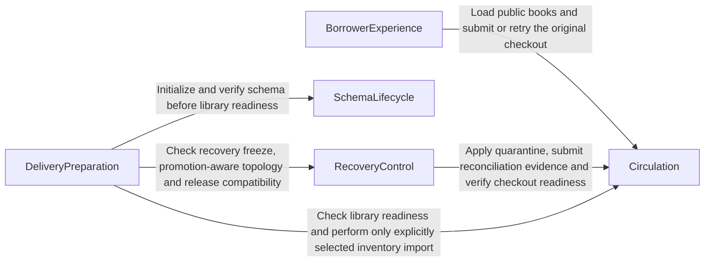

# Homenub Library — Logical Component Design

## Sources

This design realizes the approved [requirements](../requirements-analysis/requirements.md), [confirmed domain inputs](domain-design-questions.md) and [interaction specification](../refined-mockups/interaction-spec.md). The brownfield [architecture](../../../../codekb/Avengers_Project/architecture.md), [component inventory](../../../../codekb/Avengers_Project/component-inventory.md) and [dependencies](../../../../codekb/Avengers_Project/dependencies.md) identify reuse opportunities, not live resources. The approved no-live-environment correction supersedes their migration assumptions. No AWS access or deployment occurs here.

## Component Catalogue

The catalogue defines logical software ownership, not deployment units. Entity identifiers and attribute names express shape only; physical tables, types, limits, constraints, cardinalities, wire fields and recovery enforcement mechanics belong to subsequent stages. Logical entities may share a physical table. UI subcomponents do not create independent business ownership.

```yaml
components:
  -
    name: "BorrowerExperience"
    summary: "Present the catalog and guide one-book checkout."
    behaviour: "Render the approved cream/green page with keyboard access, labels, visible focus and status announcements. Distinguish loading, empty, unavailable and retry states. Validate before submission; retain the original request identifier and payload on an uncertain outcome. Display the confirmed server reference and calendar due date. Explicit demo mode uses isolated fixtures and never replaces failed production data."
    responsibilities:
      - "Catalog, book-card, form, confirmation and status presentation"
      - "Transient selection, input and uncertain-submission state"
      - "Isolated, clearly labeled local demo behavior"
    depends_on:
      -
        component: "Circulation"
        interaction: "Load public books and submit or retry the original checkout."
        style: "sync"
    dependents: []
    external_dependencies:
      -
        name: "Browser platform"
        kind: "other"
        purpose: "Native controls, page rendering, focus and HTTP transport."
    entities:
      -
        name: "CheckoutDraft"
        identifier: "draftId"
        attributes:
          - "draftId"
          - "selectedBookId"
          - "borrowerName"
          - "borrowerEmail"
          - "checkoutRequestId"
          - "submittedPayload"
          - "pageState"
        references:
          -
            entity: "Book"
            owned_by: "Circulation"
            relationship: "Identifies the selected catalog book."
          -
            entity: "CheckoutRequest"
            owned_by: "Circulation"
            relationship: "Carries the identifier submitted for durable retry resolution."
  -
    name: "Circulation"
    summary: "Own catalog inventory and authoritative checkout integrity."
    behaviour: "Return public book data without borrower records. Validate requests and, in one writable-database transaction, enforce inventory clearance, available stock, loan persistence, request identity and payload consistency. Calculate the loan due date from the server UTC calendar date plus 14 days. Retained identical requests return the original result; conflicting reuse is rejected. Uncertain recovery blocks affected stock and missing-history retries, globally when the affected set is unknown. Private operational functions require separate authority. No runtime DDL or public borrower lookup."
    responsibilities:
      - "Books and available stock; explicit repeat-safe inventory import"
      - "Loan issuance, server reference and UTC due date"
      - "Durable checkout request association and conflict detection"
      - "Inventory quarantine and evidence-based reconciliation clearance"
      - "Public catalog/checkout projection and private operational validation"
    depends_on: []
    dependents:
      -
        component: "BorrowerExperience"
        interaction: "Load public books and submit or retry the original checkout."
      -
        component: "RecoveryControl"
        interaction: "Apply quarantine, submit reconciliation evidence and verify checkout readiness."
      -
        component: "DeliveryPreparation"
        interaction: "Check library readiness and perform only explicitly selected inventory import."
    external_dependencies:
      -
        name: "MySQL database adapter"
        kind: "database"
        purpose: "Atomic loan/stock/request persistence and clearance enforcement at the transaction boundary."
      -
        name: "Regional credential and writer-verification adapters"
        kind: "other"
        purpose: "Obtain scoped SQL access and enforce proven writable authority; no routing-only fence."
    entities:
      -
        name: "Book"
        identifier: "bookId"
        attributes:
          - "bookId"
          - "title"
          - "author"
          - "availableCopies"
          - "inventorySource"
      -
        name: "Loan"
        identifier: "checkoutReference"
        attributes:
          - "checkoutReference"
          - "bookId"
          - "borrowerName"
          - "borrowerEmail"
          - "checkedOutAt"
          - "dueDate"
          - "checkoutRequestId"
      -
        name: "CheckoutRequest"
        identifier: "checkoutRequestId"
        attributes:
          - "checkoutRequestId"
          - "submittedBookId"
          - "submittedBorrowerName"
          - "submittedBorrowerEmail"
          - "checkoutReference"
      -
        name: "InventoryClearance"
        identifier: "clearanceId"
        attributes:
          - "clearanceId"
          - "scope"
          - "affectedBookIds"
          - "checkoutAllowed"
          - "incidentId"
          - "evidenceId"
          - "verifiedAt"
        references:
          -
            entity: "RecoveryIncident"
            owned_by: "RecoveryControl"
            relationship: "Identifies the recovery that requires stock clearance."
          -
            entity: "SafetyEvidence"
            owned_by: "RecoveryControl"
            relationship: "Identifies evidence supporting an operational clearance decision."
  -
    name: "SchemaLifecycle"
    summary: "Initialize compatible schema additively and repeatably."
    behaviour: "Verify writable authority before schema setup. Correct initializer configuration, apply explicitly versioned additive DDL and record completion only after verification. Preserve visitor fixtures, stock and loans across repeats; delete handling never drops user data. A revision record alone is not proof all DDL succeeded; inspect and repair partial initialization safely. Do not seed demo stock implicitly or independently initialize a read-only standby."
    responsibilities:
      - "Versioned additive schema initialization and verification"
      - "Preservation and partial-initialization recovery"
      - "Initializer input and writable-authority checks"
    depends_on: []
    dependents:
      -
        component: "DeliveryPreparation"
        interaction: "Initialize and verify schema before library readiness."
    external_dependencies:
      -
        name: "MySQL schema adapter"
        kind: "database"
        purpose: "Inspect and apply additive schema changes with privileged setup access."
      -
        name: "Regional credential and writer-verification adapters"
        kind: "other"
        purpose: "Supply setup credentials and independently verify the permitted writable target."
    entities:
      -
        name: "SchemaRevision"
        identifier: "schemaRevision"
        attributes:
          - "schemaRevision"
          - "appliedAt"
          - "definitionDigest"
  -
    name: "RecoveryControl"
    summary: "Make and record safe regional recovery decisions."
    behaviour: "Correlate failure signals outside the primary, serialize incident actions and record evidence without borrower payloads. Require old-writer fencing/draining, sufficient loss-bound evidence and target compatibility before promotion. Inspect ambiguous action outcomes before retry. Quarantine potentially affected stock before borrower writes; reopen only verified unaffected or reconciled stock after full checkout/retry validation. Unknown evidence blocks promotion or reopening and alerts. Abort never automatically reactivates the old writer; failback is controlled. Recovery remains independent of the delivery pipeline."
    responsibilities:
      - "Incident progress, exclusive action decisions, deadlines and abort"
      - "Fence/drain, loss, compatibility and routing-eligibility evidence"
      - "Quarantine/reconciliation coordination through Circulation"
      - "Public-journey verification, timing and recovery/restore test evidence"
      - "Deployment freeze and promoted-role reconciliation eligibility"
    depends_on:
      -
        component: "Circulation"
        interaction: "Apply quarantine, submit reconciliation evidence and verify checkout readiness."
        style: "sync"
    dependents:
      -
        component: "DeliveryPreparation"
        interaction: "Check recovery freeze, promotion-aware topology and release compatibility."
    external_dependencies:
      -
        name: "Durable recovery state adapter"
        kind: "other"
        purpose: "Serialize and resume incident decisions outside the primary; does not itself fence SQL writes."
      -
        name: "Regional recovery infrastructure adapters"
        kind: "other"
        purpose: "Observe signals; prove fencing/draining and loss; inspect/promote database; gate routing; check schema, assets, credentials and backups/restores."
      -
        name: "Independent observation and alert adapters"
        kind: "other"
        purpose: "Measure the public journey and signal blocked/failed recovery outside the primary."
      -
        name: "Published release artifact store"
        kind: "object-store"
        purpose: "Read immutable manifests and compatible recovery assets without invoking delivery."
    entities:
      -
        name: "RecoveryIncident"
        identifier: "incidentId"
        attributes:
          - "incidentId"
          - "sourceRegion"
          - "targetRegion"
          - "phase"
          - "startedAt"
          - "outageStartedAt"
          - "deadlineAt"
          - "abortRequested"
          - "activeWriter"
          - "manifestId"
          - "completedAt"
        references:
          -
            entity: "ReleaseManifest"
            owned_by: "DeliveryPreparation"
            relationship: "Pins the published release used for recovery compatibility checks."
      -
        name: "SafetyEvidence"
        identifier: "evidenceId"
        attributes:
          - "evidenceId"
          - "incidentId"
          - "evidenceKind"
          - "observedAt"
          - "source"
          - "result"
          - "evidenceDigest"
  -
    name: "DeliveryPreparation"
    summary: "Prepare complete releases and validated deployment configuration."
    behaviour: "Package edited local nested templates and the correctly cased App assets. Generate stable frontend API configuration and reject missing inputs or obsolete regional overrides. Prepare us-east-1/us-east-2 and www.homenub.com/api.homenub.com inputs. Sequence verified initialization before API readiness; production seed choice is explicit and repeat-safe. Check artifact/schema/runtime parity and recovery freeze/topology before deployment. This work performs local preparation only, with no AWS calls or deployment."
    responsibilities:
      - "Release manifest and complete reproducible artifacts"
      - "Generated endpoint/domain/region configuration and setup guidance"
      - "Initialization, optional inventory import and readiness sequencing"
      - "Regional parity, freeze/topology checks, cost/capacity verification inputs"
    depends_on:
      -
        component: "SchemaLifecycle"
        interaction: "Initialize and verify schema before library readiness."
        style: "sync"
      -
        component: "Circulation"
        interaction: "Check library readiness and perform only explicitly selected inventory import."
        style: "sync"
      -
        component: "RecoveryControl"
        interaction: "Check recovery freeze, promotion-aware topology and release compatibility."
        style: "sync"
    dependents: []
    external_dependencies:
      -
        name: "Workspace and build artifact storage"
        kind: "other"
        purpose: "Read authorized source and write complete local release outputs."
      -
        name: "Deployment execution adapter"
        kind: "other"
        purpose: "Prepared interface to future authorized CloudFormation/deployment outputs; never called during this work."
    entities:
      -
        name: "ReleaseManifest"
        identifier: "releaseId"
        attributes:
          - "releaseId"
          - "artifactDigests"
          - "schemaRevision"
          - "runtimeDependencies"
          - "configurationId"
        references:
          -
            entity: "SchemaRevision"
            owned_by: "SchemaLifecycle"
            relationship: "Names the required initialized schema revision."
      -
        name: "DeploymentConfiguration"
        identifier: "configurationId"
        attributes:
          - "configurationId"
          - "primaryRegion"
          - "secondaryRegion"
          - "websiteDomain"
          - "apiDomain"
          - "certificateInputs"
          - "hostedZoneInput"
          - "createDnsRecords"
          - "catalogSeedChoice"
```

## Component Diagram



Text fallback: BorrowerExperience calls Circulation for catalog and checkout. RecoveryControl calls Circulation for private quarantine, reconciliation and readiness operations. DeliveryPreparation calls SchemaLifecycle, Circulation and RecoveryControl for initialization, explicit inventory import and readiness/freeze checks. There are no reverse calls and no dependency cycle. Published release and evidence identifiers are data references; they do not create a callback or a dependency on a running pipeline.

## Component Summary

| Component | Purpose | Depends On | Dependents | Entities Owned |
|---|---|---|---|---|
| BorrowerExperience | Present the catalog and guide one-book checkout. | Circulation | None | CheckoutDraft |
| Circulation | Own catalog inventory and authoritative checkout integrity. | None | BorrowerExperience, RecoveryControl, DeliveryPreparation | Book, Loan, CheckoutRequest, InventoryClearance |
| SchemaLifecycle | Initialize compatible schema additively and repeatably. | None | DeliveryPreparation | SchemaRevision |
| RecoveryControl | Make and record safe regional recovery decisions. | Circulation | DeliveryPreparation | RecoveryIncident, SafetyEvidence |
| DeliveryPreparation | Prepare complete releases and validated deployment configuration. | SchemaLifecycle, Circulation, RecoveryControl | None | ReleaseManifest, DeploymentConfiguration |

## Entity Ownership

| Entity | Owning Component | Identifier | Attributes | References |
|---|---|---|---|---|
| CheckoutDraft | BorrowerExperience | draftId | draftId, selectedBookId, borrowerName, borrowerEmail, checkoutRequestId, submittedPayload, pageState | Circulation.Book: Identifies the selected catalog book. Circulation.CheckoutRequest: Carries the identifier submitted for durable retry resolution. |
| Book | Circulation | bookId | bookId, title, author, availableCopies, inventorySource | No cross-component reference; intra-component identifiers are listed in Attributes. |
| Loan | Circulation | checkoutReference | checkoutReference, bookId, borrowerName, borrowerEmail, checkedOutAt, dueDate, checkoutRequestId | No cross-component reference; intra-component identifiers are listed in Attributes. |
| CheckoutRequest | Circulation | checkoutRequestId | checkoutRequestId, submittedBookId, submittedBorrowerName, submittedBorrowerEmail, checkoutReference | No cross-component reference; intra-component identifiers are listed in Attributes. |
| InventoryClearance | Circulation | clearanceId | clearanceId, scope, affectedBookIds, checkoutAllowed, incidentId, evidenceId, verifiedAt | RecoveryControl.RecoveryIncident: Identifies the recovery that requires stock clearance. RecoveryControl.SafetyEvidence: Identifies evidence supporting an operational clearance decision. |
| SchemaRevision | SchemaLifecycle | schemaRevision | schemaRevision, appliedAt, definitionDigest | No cross-component reference; intra-component identifiers are listed in Attributes. |
| RecoveryIncident | RecoveryControl | incidentId | incidentId, sourceRegion, targetRegion, phase, startedAt, outageStartedAt, deadlineAt, abortRequested, activeWriter, manifestId, completedAt | DeliveryPreparation.ReleaseManifest: Pins the published release used for recovery compatibility checks. |
| SafetyEvidence | RecoveryControl | evidenceId | evidenceId, incidentId, evidenceKind, observedAt, source, result, evidenceDigest | No cross-component reference; intra-component identifiers are listed in Attributes. |
| ReleaseManifest | DeliveryPreparation | releaseId | releaseId, artifactDigests, schemaRevision, runtimeDependencies, configurationId | SchemaLifecycle.SchemaRevision: Names the required initialized schema revision. |
| DeploymentConfiguration | DeliveryPreparation | configurationId | configurationId, primaryRegion, secondaryRegion, websiteDomain, apiDomain, certificateInputs, hostedZoneInput, createDnsRecords, catalogSeedChoice | No cross-component reference; intra-component identifiers are listed in Attributes. |

CheckoutDraft is transient browser state, not a persisted borrower profile. No browser PII persistence or reload-safe uncertain-checkout recovery is promised. Loan owns self-reported borrower details. CheckoutRequest is durable request-to-loan identity; the browser's copy of its identifier is not another owner. Book, Loan, CheckoutRequest and InventoryClearance share Circulation ownership even when physically replicated to another region. SchemaLifecycle owns the schema revision ledger and DDL process, not application rows. Legacy visitor fixtures are preserved compatibility data with no new public owner or route.

## External Dependencies

| Component | Dependency | Kind | Purpose |
|---|---|---|---|
| BorrowerExperience | Browser platform | other | Native controls, page rendering, focus and HTTP transport. |
| Circulation | MySQL database adapter | database | Atomic loan/stock/request persistence and clearance enforcement at the transaction boundary. |
| Circulation | Regional credential and writer-verification adapters | other | Obtain scoped SQL access and enforce proven writable authority; no routing-only fence. |
| SchemaLifecycle | MySQL schema adapter | database | Inspect and apply additive schema changes with privileged setup access. |
| SchemaLifecycle | Regional credential and writer-verification adapters | other | Supply setup credentials and independently verify the permitted writable target. |
| RecoveryControl | Durable recovery state adapter | other | Serialize and resume incident decisions outside the primary; does not itself fence SQL writes. |
| RecoveryControl | Regional recovery infrastructure adapters | other | Observe signals; prove fencing/draining and loss; inspect/promote database; gate routing; check schema, assets, credentials and backups/restores. |
| RecoveryControl | Independent observation and alert adapters | other | Measure the public journey and signal blocked/failed recovery outside the primary. |
| RecoveryControl | Published release artifact store | object-store | Read immutable manifests and compatible recovery assets without invoking delivery. |
| DeliveryPreparation | Workspace and build artifact storage | other | Read authorized source and write complete local release outputs. |
| DeliveryPreparation | Deployment execution adapter | other | Prepared interface to future authorized CloudFormation/deployment outputs; never called during this work. |

These dependency categories retain the approved HTML/JavaScript → API Gateway/Python Lambda → MySQL RDS foundation and private S3/CloudFront hosting. They do not select new services or finalize deployment topology. Regional copies, IAM, certificates, DNS, orchestration and backups are infrastructure dependencies rather than domain components.

## Rationale

| Component | Why a separate boundary | Alternatives Rejected |
|---|---|---|
| BorrowerExperience | UI interaction and accessibility evolve separately from authoritative lending rules; only transient state is owned here. | Server-only form validation omits accessible immediate feedback; moving loan authority into the browser cannot protect stock. |
| Circulation | Stock, loan and request history require one ownership and transaction boundary. Catalog reads and checkout may use internal modules. | Separate catalog-stock and lending writers complicate atomicity; one undifferentiated application mixes borrower rules with privileged recovery/setup. |
| SchemaLifecycle | Setup privilege, versioning and partial-DDL recovery have a deployment lifecycle distinct from request processing. | Runtime schema creation gives public processing excessive privilege; one-shot unversioned setup cannot reliably trigger or verify repeat initialization. |
| RecoveryControl | Incident actions and safety evidence outlive HTTP requests and need independent observation/access. | Browser retry/routing-only recovery cannot prove SQL fencing; embedding control in the build pipeline ties recovery to delivery availability. |
| DeliveryPreparation | Build inputs, configuration and artifact parity change on releases, not on borrower requests. | Hardcoded deployed endpoints break reproducibility; runtime recovery invoking the pipeline adds an unnecessary incident dependency. |

The five-boundary option was confirmed in domain inputs; stage approval ratifies the catalogue. Alternatives discussed before selection were separate Catalog/Lending ownership and an all-purpose component. Both are reversible through later extraction, but impose transaction or privilege/lifecycle coupling now. [ADR-001 through ADR-004](decisions.md) retain the significant tradeoffs. No cycle is required.

## Interaction and Integrity Boundaries

- **Browse:** BorrowerExperience requests a public Book projection through Circulation. Availability is informational until checkout commits. No visitor location collection, public visitor lookup, borrower list or loan lookup is carried forward.
- **Checkout:** the browser submits a selected book, self-reported name/email and its request identifier. Circulation validates the complete request and verified writer/clearance authority. Stock, loan and durable request association commit together; rollback leaves all unchanged. A concurrent last-copy checkout cannot bypass that transaction boundary.
- **Retry:** an uncertain outcome retains the original identifier and payload. Retained matching history resolves to the same reference/date without another decrement; conflicting reuse is rejected. Quarantine prevents an uncertain missing-history retry from becoming a new loan. No global exactly-once claim is made after asynchronous history loss.
- **Setup:** DeliveryPreparation supplies a schema revision and verified target to SchemaLifecycle, which independently verifies writable authority and completes additive setup before library readiness. Verification, rather than an assumed transactional DDL rollback, governs restart after partial setup. Circulation alone performs an explicitly authorized, repeat-safe inventory import; schema setup never silently seeds or resets stock.
- **Recovery:** RecoveryControl checks corroborated failure, incident exclusivity, target release/schema/credential readiness, proof of old-writer fencing and drained transactions, and sufficient loss evidence before promotion. It blocks and alerts on unknown, stale, contradictory or excessive evidence. It inspects ambiguous promotion outcomes before retrying. Initial borrower writes on the promoted target default closed until Circulation has verified clearance.
- **Reopening:** applying a recovery incident must not leave an old replicated clearance flag able to open the new writer. Functional/contract design must bind clearance to the current incident and writer authority, reject stale evidence, and serialize quarantine/clearance changes with checkout. Unknown affected stock means a global block. Reconciliation verifies physical availability and uncertain loan/request history through private operational functions, with evidence and authorized operating access; it does not introduce a staff UI or public clearance endpoint.
- **Verification while blocked:** a readiness check may inspect health/schema without clearing quarantine. Any synthetic checkout used before borrower reopening requires a dedicated, identified test book and operational authority; it cannot bypass quarantine on potentially affected borrower stock. The required public checkout/retry journey follows clearance. Test cleanup must not assume a borrower-facing returns feature; its controlled procedure belongs in the recovery test design.
- **Authority:** RecoveryControl coordinates evidence and invokes adapters; Circulation enforces local transaction admission and its database adapter enforces SQL access. Neither a controller lock, a clearance row, DNS, disabled ingress nor a Lambda setting proves old-writer fencing. SchemaLifecycle must verify authority without requiring its not-yet-created revision ledger. Concrete credentials, fences, session draining, evidence freshness/expiry and failure behavior must be specified and demonstrated before automatic promotion is accepted.
- **After promotion:** old-primary return does not restore its write permission or cause automatic failback. DeliveryPreparation consults the incident/freeze boundary and actual role compatibility before allowing routine updates; published immutable manifests remain available to RecoveryControl without a running pipeline.

## Brownfield Integration

| Observed code area | Domain responsibility | Required reuse/update |
|---|---|---|
| `App/index.html`, `App/app.js`, `App/style.css` | BorrowerExperience | Replace visitor UI/geolocation with approved catalog/form/status behavior; reuse plain frontend and correct packaging casing. |
| `cfn/visitor-insert-lambda.yml` | Circulation | Replace visitor public routes/SQL behavior with catalog and checkout; retain useful connection/event patterns and separate runtime privileges. |
| `cfn/DBinit-lambda.yaml` | SchemaLifecycle | Correct input/environment mismatch, version trigger and additive initialization; connect to delivery sequencing. |
| `buildspec/` and `cfn/` configuration | DeliveryPreparation | Package edited local templates/assets, inject generated configuration, validate regions/domains and maintain the existing stack-name conventions. |
| No existing recovery-controller code | RecoveryControl | New recovery decision/evidence logic and infrastructure adapters, with explicit safety proof and failure tests. |

Source reuse does not imply existing deployment or records. Active configuration/setup uses Ohio in place of London directly; no migration/backfill/retirement work is created. Preserve the requested VPC, DB sizing, replication baseline and stack names unless a later explicit design decision is needed for recovery feasibility. Domain boundaries do not rename infrastructure resources.

## Requirement Coverage

[traceability.json](traceability.json) maps every functional requirement to a declared component. “OK” there means assigned design ownership, not implementation/test completion.

| IDs | Primary owner | Supporting responsibility |
|---|---|---|
| FR1 | Circulation | BorrowerExperience presents title/author/count and distinct empty/error states. |
| FR2 | BorrowerExperience | Circulation owns repeat-safe explicit production inventory import; DeliveryPreparation requires owner selection. |
| FR3 | BorrowerExperience | Circulation performs authoritative input/book validation. |
| FR4–FR6 | Circulation | BorrowerExperience displays the server date/result and preserves uncertain request identity. |
| FR7 | BorrowerExperience | Approved focus, labels, live status and responsive interaction specification. |
| FR8 | Circulation | Delivery adapters expose only the contracted public routes/methods. |
| FR9 | SchemaLifecycle | DeliveryPreparation sequences verified initialization before readiness. |
| FR10 | DeliveryPreparation | Complete local artifacts and generated stable API configuration. |
| FR11–FR12 | RecoveryControl | DeliveryPreparation supplies regional parity; Circulation enforces admission and inventory clearance. |
| FR13 | DeliveryPreparation | Ohio source/default/override/package/setup consistency checks. |
| FR14 | RecoveryControl | DeliveryPreparation supplies restore/parity/test assets; Circulation supplies persistence and quarantine evidence. |

| NFR | Accountable component(s) | Evidence obligation carried forward |
|---|---|---|
| NFR1 | RecoveryControl | Measure 15-minute target from interruption through public successful Ohio checkout, including reconciliation/cache delay; report misses. |
| NFR2 | RecoveryControl, Circulation | Prove at-most-five-minute loss bound using acknowledged loan/request history; unknown evidence blocks promotion; quarantine uncertain stock/history. |
| NFR3 | Circulation, RecoveryControl | Real MySQL concurrency, rollback, durable uniqueness and old-writer partition/fencing tests. |
| NFR4 | All components | Private/TLS database and scoped setup/runtime/recovery authority, OAC, validated inputs, redacted errors/logs and no public borrower lookup. |
| NFR5 | RecoveryControl | Durable detecting/blocked/promoting/validating/active/failed-aborted progress and independent alerts, with incident correlation and no borrower payloads. |
| NFR6 | DeliveryPreparation, RecoveryControl | Document both-region cost/workload assumptions before deployment; preserve small baseline sizing until evidence supports a change. |
| NFR7 | All components | Carry all six pillar controls below to the detailed designs and test evidence. |
| NFR8 | All components; DeliveryPreparation integrates CI | Repeatable local/static, real-MySQL and later authorized cloud-drill checks remain distinctly reported. |

## Well-Architected Responsibilities

These are allocations of the approved six-pillar requirement, not a certification or a live-account assessment.

| Pillar | Component responsibilities | Later verification |
|---|---|---|
| Operational excellence | RecoveryControl owns observable incident/abort state and operating evidence; DeliveryPreparation owns release parity and freeze/topology checks. | Restart/duplicate/ambiguous-action scenarios, outside-primary alert path and recovery drill evidence. |
| Security | BorrowerExperience minimizes transient PII; Circulation isolates borrower data; SchemaLifecycle and RecoveryControl separate privileged actions; DeliveryPreparation validates secure configuration. | Negative route/auth/log tests, private/TLS/encryption/OAC/IAM template checks and later authorized access verification. |
| Reliability | Circulation protects atomic stock/loan/request history and quarantine; RecoveryControl requires proof before promotion/reopening and covers backups/restores. | Real last-copy races, rollback, partitions, stale clients, missing acknowledged history, restore checks and measured RTO/RPO. |
| Performance efficiency | Circulation exposes measurable database/checkout work; BorrowerExperience avoids unnecessary page work; RecoveryControl uses bounded actions. | Measure latency and connection pressure at an explicitly selected workload before resizing or tuning. |
| Cost optimization | DeliveryPreparation records a two-region estimate; RecoveryControl justifies standby/control scope against the approved targets. | Account for DB/HA, NAT/network, replication/transfer, backup, DNS/certificates, monitoring and drills with pricing assumptions. No cost claim yet. |
| Sustainability | BorrowerExperience reuses static assets; DeliveryPreparation and RecoveryControl document capacity/retention choices proportional to recovery evidence. | Check artifact/log retention, standby utilization and sizing rationale; no emissions or savings claim. |

## Assumptions & Open Questions

No unresolved business choice is required for these ownership boundaries. The confirmed requirements and domain inputs remain the authority.

The concrete SQL fencing/draining protocol, loss-bound evidence, transaction admission during quarantine transitions, private reconciliation contract, initial authority bootstrap and synthetic-test isolation remain mandatory downstream design/proof work. They are not supplied by a component name or local flag. Functional/NFR/infrastructure design must define them and their negative tests before accepting automatic promotion; inability to meet the retained design's objectives requires an explicit tradeoff, not silently weakened safety.

Launch inputs remain catalog approval, retention/deletion policy, operating/alert ownership, required region/domain/certificate/hosted-zone values, driver availability and both-region pricing. No duration or contact is invented. Future cloud drills require separate authorization; no recovery, restore, responsive-browser or performance result is asserted here.

## Validation

The component catalogue is checked for unique names/owners, valid references, symmetric acyclic dependencies and complete FR1–FR14 ownership. The diagram uses a restricted flowchart grammar checked before writing, with the text fallback above; no Mermaid renderer is available. Local links and JSON traceability are checked before handoff. These document checks do not demonstrate database or AWS recovery behavior.

