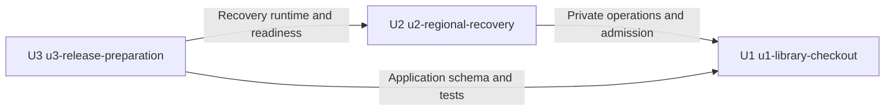

# Homenub Library — Unit Dependencies

## Sources

The approved [plan](decomposition-plan-approval.md), [unit definitions](unit-of-work.md), [domain components](../domain-design/components.md) and [requirements](../requirements-analysis/requirements.md) define this dependency topology. No economic build order, critical path or Bolt sequence is selected here.

## Dependency DAG

An edge A → B means A depends on B. Unit names equal the construction directories in unit-of-work.md. The YAML block is the machine-readable source of truth.

```yaml
units:
  - name: u1-library-checkout
    kind: service
    depends_on: []
  - name: u2-regional-recovery
    kind: service
    depends_on: [u1-library-checkout]
  - name: u3-release-preparation
    kind: packaging
    depends_on: [u1-library-checkout, u2-regional-recovery]
```

## Dependency Diagram



Text fallback: U1 has no implementation-unit dependency. U2 depends on U1. U3 depends on U1 and U2. There are no other edges or cycles. Runtime recovery uses a published manifest schema/object; it never invokes a running packaging pipeline.

## Integration Points

| Consumer | Provider | Integration boundary | Failure / compatibility obligation |
|---|---|---|---|
| U2 | U1 | Private quarantine/reconciliation/readiness; transaction/connection authority enforcement; schema and public checkout checks | Separate authorization; reject stale incident evidence and unknown authority. Unknown affected stock blocks all checkout. No direct U2 writes to Circulation tables. |
| U3 | U1 | Source/API/initializer templates and outputs, schema version/setup result, explicit import and application verification entry points | Reject missing/null outputs or invalid authority; complete initialization before readiness; no implicit catalog seed/reset. |
| U3 | U2 | Recovery/regional runtime templates, readiness/freeze/topology results and recovery/restore verification entry points | Reject unknown freeze or incompatible promoted role. Initial bootstrap is explicit; a previously active system cannot treat missing incident state as safe. |
| BorrowerExperience inside U1 | Circulation inside U1 | GET /books and POST /checkouts | Public data only, validated requests, original-ID retry and server-calculated confirmation. This is an intra-unit component edge. |
| SchemaLifecycle inside U1 | Database/authority adapters | Verified writable setup target, additive schema/revision verification | No dependency on uncreated library tables for authority bootstrap; no standalone writes on a replica. This is an external dependency, not another unit. |

Wire fields, authorization protocols, evidence validity/expiry and compatibility/version rules are Contract Design outputs, not invented here.

## Passive Artifacts and No Reverse Runtime Dependency

U3 owns ReleaseManifest and generated DeploymentConfiguration production. Contract Design fixes their schemas before implementation. U1/U2 consume that shared specification and controlled fixtures for isolated tests; this does not require U3's implementation to run. In an actual authorized release, U3 publishes the real compatible assets/configuration/manifest and recovery readiness checks their presence and digests. An unavailable or incompatible object blocks readiness. Once published, U2 reads it through an artifact-store adapter without invoking the release tooling.

The distinction is code/specification dependency versus availability of a deployed passive artifact. No empty manifest, fixture or assumed pipeline success may establish production recovery readiness. Ownership remains with U3, and runtime availability of the object is a deployment precondition.

## Root Integrated Slice

U1 is the sole dependency root and the first resolved DAG unit if Construction's walking-skeleton policy applies. It contains a real borrower page, an HTTP path into the application handler, real MySQL transaction persistence and an additive initializer. It can verify a successful checkout and identical retry with persisted loan, stock and server date before U2/U3 implementations exist.

A local integration configuration supplies its explicit database connection and page/API address through a minimal U1-owned helper. This is local verification, not a hardcoded deployed endpoint or a production substitute for U3's generated configuration. Real MySQL is required for locking/rollback/uniqueness claims. A demo-only page, mock database or design-only review is not the integrated demonstration.

U1 includes contracted private operations and conservative authority/clearance enforcement. It does not silently enable regional promotion or bypass missing recovery proof. Final human-authorized integrated verification command and any skeleton checkpoint follow the applicable Construction policy; this topology does not grant those approvals. Complete two-region launch acceptance still requires U2/U3 and the defined cloud evidence.

## Parallel Development Opportunities

There is no independent pair in the approved three-unit DAG: each pair is linked by a dependency. Therefore the DAG does not authorize parallel implementation batches. Independent unit-level tests and contract-fixture work may be possible once the shared contracts are pinned, but do not erase the integration dependencies or justify claiming an unfinished provider is complete.

This records dependency constraints only. It does not recommend economic priority, choose a critical path or add Delivery Planning to the approved composed scope.

## Validation

Check declared unit-name grammar, unique membership, allowed kinds, resolved non-self dependencies and acyclicity. Compare diagram and prose edges with the YAML; compare all Unit IDs/directories with the unit definitions and requirement map. These are local document checks, not deployment, performance or failover evidence.

